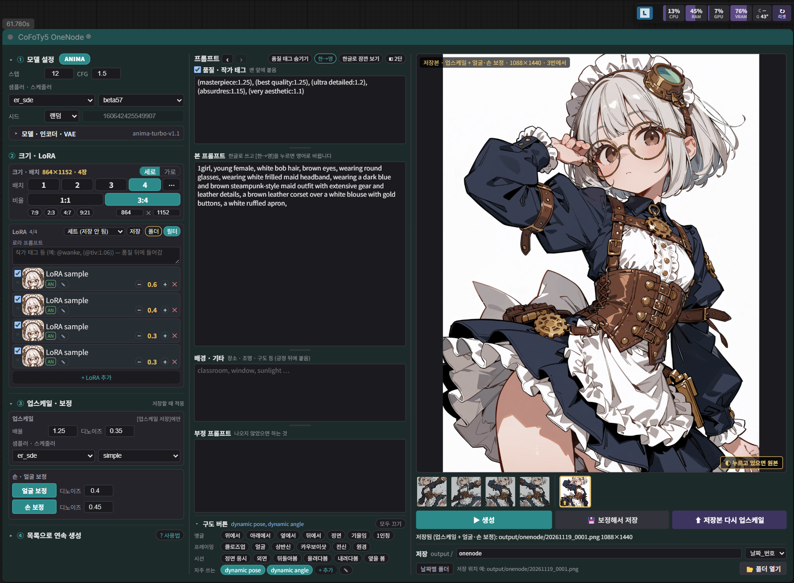

# CoFoTy5 OneNode

**클릭 몇 번으로 애니메이션 그림 AI를 내 PC에서 쓸 수 있게 해 주는 설치 프로그램입니다.**
설치가 끝나면 **한 화면**에서 글을 쓰고, 버튼을 눌러 그림을 만들 수 있습니다.

<!-- 화면 캡처를 넣으려면 docs 폴더를 만들고 아래 줄의 주석을 풀어 주세요

-->

- 쓰고 싶은 그림을 글로 적고 **▶ 생성**을 누르면 끝입니다
- 한글로 적고 **[한→영]** 을 누르면 AI가 알아듣는 영어로 바꿔 줍니다
- 마음에 드는 그림만 골라 **⬆ 업스케일 저장**
- 표정 · 포즈를 목록으로 적어 두면 **한 번에 이어서** 만들고, 결과를 한 화면에서 검수해 **잘못 나온 것만 다시** 만들 수 있습니다
- 자주 쓰는 LoRA 조합을 **썸네일이 붙은 세트**로 저장해 두고 그림을 보며 골라 쓸 수 있습니다
- 설치할 때 **가속 기능**을 고르면 그림 만들기가 빨라질 수 있습니다 (RTX 30 이상 권장)

---

## 먼저 확인해 주세요

| 항목 | 필요한 것 |
|---|---|
| 컴퓨터 | Windows 10 / 11 |
| 그래픽카드 | **NVIDIA** 지포스 RTX 20 시리즈 이상 (AMD · 인텔 그래픽은 안 됩니다) |
| 그래픽 메모리 | 8GB 권장 |
| 저장 공간 | 약 22GB |
| 인터넷 | 설치할 때 약 8GB를 받습니다 |

**파이썬이나 Git 같은 것을 따로 설치하지 않아도 됩니다.** 필요한 것은 모두 받아서 설치 폴더 안에만 넣습니다.
잘 모르겠으면 일단 설치를 시작하세요. 설치 프로그램이 컴퓨터를 **자동으로 확인**하고, 문제가 있으면 고치는 방법을 알려 줍니다.

---

## 설치하기 (3단계)

**1. 받기** — 이 페이지 오른쪽의 **Releases**(또는 [여기](../../releases/latest))에서 `CoFoTy5-OneNode_v….zip` 을 받습니다.

**2. 압축 풀기** — 받은 파일을 **오른쪽 클릭 → [모두 압축 풀기]** 합니다.
> zip 파일 안에서 바로 실행하지 마세요. 꼭 압축을 풀어야 합니다.

**3. 실행** — 풀린 폴더의 **`OneNode_Setup.bat`** 를 두 번 누릅니다.
설치 창이 열리면 **[다음]** 만 누르면 됩니다. (20분~1시간 걸립니다)

> **파란색 "Windows의 PC 보호" 창이 뜨면 정상입니다.**
> **[추가 정보] → [실행]** 을 누르세요. (개인이 만든 프로그램은 항상 이 창이 뜹니다. 코드는 이 저장소에 모두 공개되어 있습니다.)

설치가 끝나면 **[지금 시작하기]** 를 누르거나, 바탕화면의 **CoFoTy5 OneNode** 아이콘을 두 번 누르세요.
검은 창이 뜨고 작업 화면이 열리면 **검은 창은 저절로 작업 표시줄로 내려갑니다.** 그 창을 닫으면 꺼지니 **닫지 말고 두세요.**

> **설치가 중간에 끊겼나요?** 설치 프로그램을 다시 실행하고 같은 폴더를 고르세요. 받은 데까지 이어서 합니다.

---

## 쓰는 법

1. **본 프롬프트**에 그리고 싶은 것을 적습니다. 한글로 적고 **[한→영]** 을 눌러도 됩니다.
2. **▶ 생성**을 누르면 미리보기 그림이 2장 나옵니다.
3. 아래 작은 그림 중 마음에 드는 것을 눌러 고르고 **⬆ 업스케일 저장**을 누릅니다.
   손이 어색하면 **얼굴 · 손 보정**을 켜고 다시 눌러 보세요.
4. 저장한 그림은 **📂 폴더 열기**로 볼 수 있습니다.

<!--  -->

**알아 두면 편한 것**
- **구도 버튼**(부정 프롬프트 아래): 앵글 · 시선 같은 것을 눌러서 넣습니다. `웃음=smile` 처럼 내 버튼도 만들 수 있습니다.
- **[한글로 잠깐 보기]**: 영어 프롬프트가 무슨 뜻인지 한글로 보여 주기만 합니다. 다시 누르면 원래대로 돌아옵니다.
- **LoRA**(그림체를 바꾸는 추가 파일): `설치폴더\ComfyUI_windows_portable\ComfyUI\models\loras` 에 넣고, 화면의 **+ LoRA 추가**에서 고릅니다.
- **LoRA 세트**: LoRA 제목 줄의 **저장**을 누르면 지금 LoRA 조합 + 작가 태그를 세트로 저장합니다. 이때 지금 보고 있는 그림이 세트 썸네일이 됩니다. **세트 선택**을 누르면 세트가 썸네일로 나오고, 눌러서 바로 적용합니다.
- **⚡ 가속**(① 모델 설정 제목 줄): 눌러서 켜고 끕니다. 설치 프로그램 없이 노드 폴더만 복사했다면 **가속 (시험 안 함)**으로 보이는데, 눌러서 시험하면 됩니다(그 ComfyUI의 파이썬에 Triton · SageAttention이 있어야 함). **사용 불가**로 보이면 이 PC에서는 가속이 안 되는 것이고, 그림 만들기는 평소처럼 됩니다. 옆의 **다시 시험**으로 다시 확인할 수 있습니다.
- 위쪽 **↻ 리셋**: ComfyUI를 다시 켭니다. 절전 모드에서 깬 뒤 그림이 안 만들어지면 눌러 보세요.

### 표정 · 포즈를 목록으로 이어서 만들기
1. 노드 왼쪽 아래 **④ 목록으로 연속 생성**을 펼치고 **📂**를 눌러 폴더를 엽니다. (예시 파일이 들어 있습니다)
2. 엑셀이나 메모장에 적은 내 목록 파일을 그 폴더에 넣고 **↻**를 누른 뒤, 만들 항목에 체크합니다.
3. 방식을 고르고 **▶ 시작**을 누릅니다.
   - **⚡ 바로 저장 / ⚡ 업스케일 저장**: 끝까지 알아서 만듭니다
   - **👀 보면서 진행**: 항목마다 직접 골라 저장합니다

파일 이름 앞에 항목 이름이 붙어서 저장됩니다. (예: `웃음_20261111_0001.png`)

⚡ 방식은 다 만들고 나면 **목록 생성 결과** 창이 열립니다.
- 그림을 누르면 **재생성 대기**로 표시되고, 목록에는 그 항목만 체크됩니다. 창을 닫고 **▶ 목록 생성 시작**을 다시 누르면 잘못 나온 것만 다시 만듭니다.
- 그림마다 **[프롬프트]**(쓴 프롬프트 보기) · **[삭제]**(휴지통 폴더로, 한 번 더 누르면 복원) 버튼이 있습니다.
목록 파일 쓰는 법은 노드 안의 **? 사용법** 버튼에 있습니다. 구글 스프레드시트는 **엑셀(.xlsx)이나 CSV로 내려받아** 넣으면 됩니다.

---

## 자주 묻는 질문

**설치 창이 안 떠요.**
압축을 완전히 풀었는지 확인하세요. 백신이 막았다면 이 폴더를 예외로 두고 다시 실행하세요.

**"드라이버가 오래되었습니다"라고 나와요.**
[NVIDIA 사이트](https://www.nvidia.com/ko-kr/drivers/)에서 최신 드라이버를 설치한 뒤 **[다시 확인]**을 누르세요.

**켰는데 작업 화면이 아니라 다른 상자들만 떠 있어요.**
위쪽 메뉴의 **CoFoTy5 OneNode › OneNode 노드 새로 놓기**를 누르세요. 안 되면 압축 안의 `CoFoTy5_OneNode_워크플로.json` 파일을 화면에 끌어다 놓으면 됩니다.

**탭을 실수로 닫았어요.**
왼쪽 메뉴의 **워크플로**를 열면 **즐겨찾기** 맨 위에 **CoFoTy5 OneNode**가 있습니다. 눌러서 다시 여세요.

**전에 쓰던 LoRA가 "사용 불가"로 떠 있어요.**
브라우저에 남아 있던 예전 작업 화면일 수 있습니다. 위의 `CoFoTy5_OneNode_워크플로.json`을 화면에 끌어다 놓으면 깨끗한 화면으로 열립니다.

**검은 창에 빨간 글씨가 나오고 안 켜져요.**
설치 프로그램을 다시 실행해서 **같은 폴더**를 고르세요. 빠지거나 손상된 파일만 다시 받고 노드를 원래대로 고칩니다. (만든 그림 · LoRA · 모델은 그대로 둡니다) 그래도 안 되면 `설치폴더\_installer\install.log` 파일을 함께 보내 주세요.

**⚡ 가속이 "사용 불가"로 떠요.**
그래픽카드가 오래되었거나(주로 RTX 20 시리즈 이하) 부품 버전이 맞지 않는 경우입니다. 그림 만들기에는 영향이 없습니다. 표시에 마우스를 올리면 이유가 보이고, 드라이버나 ComfyUI를 바꾼 뒤에는 **다시 시험**을 눌러 보세요.

**그림이 너무 느리게 나와요.**
게임이나 영상 같은 다른 프로그램이 그래픽카드를 쓰고 있을 수 있습니다. 끄고 다시 해 보세요.

**[한→영]이 안 돼요.**
인터넷 연결이 필요합니다. 짧은 시간에 아주 많이 쓰면 잠시 막힐 수 있으니 조금 뒤에 다시 눌러 보세요.

---

## 지우기

설치 폴더의 **`Uninstall_OneNode.bat`** 를 실행하세요. 만든 그림은 바탕화면으로 옮겨 둘 수 있습니다.
또는 ComfyUI를 끈 뒤 **설치 폴더를 통째로 지워도 됩니다.** 윈도우에는 아무것도 남지 않습니다. (바탕화면 아이콘만 따로 지워 주세요)

---

## 알아 두세요 (라이선스)

- 그림을 만드는 **Anima 모델은 비상업 라이선스**입니다. 만든 그림에는 이 제한이 걸리지 않지만, 모델 파일 자체를 팔거나 유료 서비스에 쓰는 것은 안 됩니다. ([라이선스 전문](https://huggingface.co/circlestone-labs/Anima/blob/main/LICENSE.md))
- 이 저장소의 코드(설치 프로그램 · OneNode 노드)는 **GPL-3.0** 입니다.

---

## 더 알고 싶은 분을 위한 자세한 내용

아래는 몰라도 쓰는 데 지장이 없습니다. 필요할 때만 펼쳐 보세요.

<details>
<summary><b>Illustrious · NoobAI 같은 다른 모델(체크포인트) 쓰기</b></summary>

&nbsp;

설치판에는 Anima만 들어 있습니다. SDXL 계열 **체크포인트**도 쓰고 싶다면:

1. 받은 체크포인트 파일(`.safetensors`)을 `설치폴더\ComfyUI_windows_portable\ComfyUI\models\checkpoints` 에 넣습니다. (파일마다 라이선스가 다르니 받은 곳의 안내를 확인하세요)
2. 노드의 **① 모델 설정 → 모델 · 인코더 · VAE**를 펼쳐 **체크포인트** 칸에서 고릅니다.
3. 모델 설정 옆 표시가 **ANIMA → SDXL·IL** 로 바뀌고, 스텝 · CFG · 샘플러 · 품질 태그 · 부정 프롬프트 · LoRA가 체크포인트용으로 바뀝니다. Anima로 돌아가면 예전 값이 그대로 돌아옵니다.

- 체크포인트는 인코더 · VAE가 파일 안에 들어 있어서 그 칸은 잠기고, **CLIP Skip**(보통 2)이 새로 보입니다.
- LoRA는 모델 종류가 맞아야 합니다. 목록에는 **지금 모델용만** 보이고(**필터**로 끌 수 있음), LoRA 세트 이름 앞에는 **An**(Anima용) · **IL**(SDXL·IL용) · **15**(SD1.5용)가 붙습니다.
- 체크포인트는 문장보다 태그 위주 프롬프트가 잘 맞습니다.

</details>

<details>
<summary><b>LoRA 세트 · 사전 · 설정은 어디에 저장되나요</b></summary>

&nbsp;

- LoRA 세트(로라 프롬프트 포함) · 태그 사전 · 고친 번역은 설치 폴더 안 `ComfyUI\user\cofoty5` 에 저장됩니다.
- 설치 폴더를 지우면 함께 지워지고, 다른 ComfyUI와는 섞이지 않습니다.
- 위치를 바꾸고 싶으면 LoRA 화면의 **폴더** 버튼을 누르세요. 예전에 쓰던 폴더를 고르면 거기 있던 세트를 그대로 쓸 수 있습니다.
- **로라 프롬프트**(작가 태그 등)는 그림을 만들 때 품질 태그 바로 뒤에 들어갑니다.

</details>

<details>
<summary><b>가속 기능은 무엇을 설치하고, 어떻게 동작하나요</b></summary>

&nbsp;

- 설치 3단계의 **가속 기능** 체크(기본 켜짐)를 하면 **Triton**(`triton-windows`, PyTorch 버전에 맞춰 고름) · **SageAttention** 2.2 · 파이썬 보조 파일(`python_embeded\include` · `libs`)을 설치합니다. PyTorch와 다른 부품은 건드리지 않습니다.
- 설치 끝에 그래픽카드에서 작은 계산을 실제로 돌려 보고, 결과를 `ComfyUI\user\cofoty5_accel.json` 에 기록합니다. 통과하면 켜지고, 안 되면 **사용 불가**로 꺼 둡니다. 불러오기부터 안 되면 ComfyUI 시작을 방해하지 않도록 SageAttention을 다시 지웁니다.
- 켜져 있으면 생성 · 업스케일 · 손얼굴 보정을 할 때 **Sage Attention**과 **fp16 누적**(토치 설정)을 함께 씁니다. 원래 모델은 바꾸지 않고, 쓰는 동안만 적용합니다.
- 쓰는 도중 오류가 나면 그 자리에서 기본 계산으로 돌아가고 **사용 불가**로 바뀝니다. **다시 시험**으로 풀 수 있습니다.
- 그래픽카드 없이(CPU로) 설치할 때는 고를 수 없습니다.

</details>

<details>
<summary><b>설치되는 것들과 출처 · 라이선스</b></summary>

&nbsp;

받은 파일은 모두 공식 주소에서 받고, **SHA256**으로 원본과 같은지 확인합니다. 버전은 검증된 것으로 고정되어 있습니다.

| 부품 | 출처 | 크기 | 라이선스 |
|---|---|---|---|
| ComfyUI 포터블 v0.44.0 (NVIDIA) | [Comfy-Org/ComfyUI](https://github.com/Comfy-Org/ComfyUI) | 2.0GB | GPL-3.0 |
| ComfyUI-Manager | ComfyUI에 들어 있음 (켜기만 함) | – | GPL-3.0 |
| Anima 터보 v1.1 · Qwen3 0.6B · Qwen-Image VAE | [circlestone-labs/Anima](https://huggingface.co/circlestone-labs/Anima) | 5.6GB | **비상업** (CircleStone Labs Non-Commercial) |
| Impact Pack 8.30 · Impact Subpack 1.3.4 (보정, 선택) | [ltdrdata](https://github.com/ltdrdata) | 소용량 | GPL-3.0 / AGPL-3.0 |
| 얼굴 · 손 감지 모델 (선택) | [Bingsu/adetailer](https://huggingface.co/Bingsu/adetailer) | 74MB | Apache-2.0 |
| LoRA Manager v1.2.8 (선택) | [willmiao/ComfyUI-Lora-Manager](https://github.com/willmiao/ComfyUI-Lora-Manager) | 소용량 | GPL-3.0 |
| Triton for Windows · SageAttention 2.2 (가속, 선택) | [triton-windows](https://github.com/triton-lang/triton-windows) · [woct0rdho/SageAttention](https://github.com/woct0rdho/SageAttention) | 수십 MB | MIT / Apache-2.0 |
| 7-Zip 콘솔(7zr) — 압축 풀기용 | [7-Zip](https://www.7-zip.org) | 0.6MB | LGPL |
| 한국어 태그 사전 (처음 번역할 때 물어봄) | [chiharoong/danbooru-tags-kr](https://huggingface.co/datasets/chiharoong/danbooru-tags-kr) | – | MIT |

손 · 얼굴 보정 모델을 받지 못해도 설치는 끝까지 진행됩니다. (그림 만들기에는 영향이 없습니다)

</details>

<details>
<summary><b>설치된 폴더 구조 (ComfyUI 공식 구조 그대로)</b></summary>

&nbsp;

```
C:\CoFoTy5-OneNode\
├─ CoFoTy5_OneNode.exe            ← 켜기 (바탕화면 아이콘이 가리키는 파일)
├─ Start_OneNode.bat              ← 켜기 (exe가 안 될 때 쓰는 예비)
├─ Uninstall_OneNode.bat          ← 지우기
├─ README_설치폴더.txt
├─ _installer\                    ← 설치 기록 · 지우기 도구
└─ ComfyUI_windows_portable\      ← ComfyUI 공식 포터블판 (그대로)
   └─ ComfyUI\
      ├─ custom_nodes\cofoty5_onenode\   ← OneNode 노드
      ├─ models\  output\  …
```

인터넷의 ComfyUI 강좌 · 워크플로를 그대로 쓸 수 있고, 위쪽 메뉴의 **Manager**로 다른 노드도 설치할 수 있습니다.
다만 ComfyUI 업데이트나 다른 노드 설치 뒤에는 OneNode 노드가 동작하지 않을 수도 있습니다. 그럴 때는 설치 프로그램을 다시 실행해 복구하세요. 큰 업데이트 전에는 설치 폴더를 통째로 복사해 두면 안전합니다.

</details>

<details>
<summary><b>새 버전이 나왔을 때 부품 업데이트하기</b></summary>

&nbsp;

이 설치 프로그램은 항상 최신이 아니라 **확인된 버전으로 고정**해서 설치합니다. 그래서 언제 설치해도 같은 결과가 나옵니다. 새 버전으로 바꾸고 싶다면 직접 하셔야 합니다.

| 바꾸고 싶은 것 | 방법 |
|---|---|
| ComfyUI 본체 | `ComfyUI_windows_portable\update` 폴더의 `update_comfyui.bat` 실행 |
| 손 · 얼굴 보정 / LoRA 매니저 같은 확장 | ComfyUI 화면의 **Manager**에서 업데이트 |
| 그림 모델 · 보정 모델 | 새 파일을 `ComfyUI\models` 안의 해당 폴더에 넣기. 설치 프로그램을 다시 실행해도 이미 있는 파일은 지우거나 덮어쓰지 않습니다 |
| 설치 프로그램이 받는 주소 | `installer\manifest.json`을 메모장으로 열어 `url`을 바꾸고, `sha256`(파일 확인 값)을 새 값으로 바꾸거나 `""`(빈 값)로 두면 확인을 건너뜁니다 |

</details>

<details>
<summary><b>노드 화면 구성 자세히 (고급)</b></summary>

&nbsp;

화면 배치(2단 · 3단), 모델 설정, LoRA 세트, 구도 버튼 등 노드 안 기능의 자세한 설명은 [cofoty5_onenode/README.md](cofoty5_onenode/README.md)에 있습니다.

</details>
